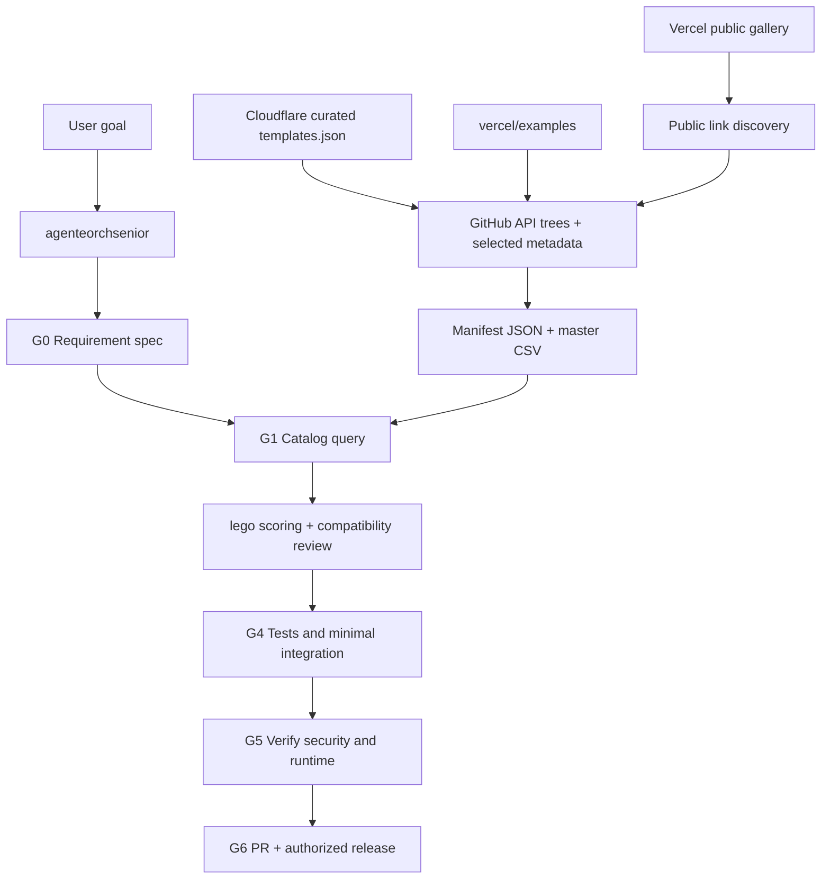

# Manus LEGO — Full Pipeline Specification

## Purpose and measurable outcome
Convert a plain-language app goal into a traceable selection plan for reusable Cloudflare/Vercel templates. Use GitHub metadata and file references. Do not mirror the full source and do not deploy it during inventory.

## Data plane and control plane

## Workflow gates
| Gate | Input | Pass condition | Fail action |
|---|---|---|---|
| G0 · SPEC | User goal, scope | EARS requirements with acceptance criteria | Resolve material ambiguity |
| G1 · SOURCES | Catalogue and GitHub | Commit SHA, file paths, README, provenance | Keep candidate unverified |
| G2 · MATCH | Runtime, bindings, licenses | Compatible target, explicit adapter plan, ADR | Reject mismatched template |
| G3 · SECURITY | Identity, dependencies, secrets | Threat review and approved license | Block reuse |
| G4 · IMPLEMENT | Minimal paths | Tests fail before change and pass after | Repair in isolated branch |
| G5 · VERIFY | Candidate deployed locally | Tests, build, integration, documentation pass | Record unresolved blockers |
| G6 · RELEASE | PR, evidence, approval | User authorizes target, secrets and production | Stay un-deployed |

## Source policy
- Cloudflare canonical monorepo: https://github.com/cloudflare/templates; `templates.json` enumerates curated templates, each template's `package.json.cloudflare` records labels/products/categories/publish where present.
- Vercel official examples monorepo: https://github.com/vercel/examples; individual examples use README metadata. Not all community Vercel marketplace entries are in this repository.
- Vercel gallery: https://vercel.com/templates; discover public links and GitHub source; do not rely on undocumented internal APIs or private scraping.
- Cloudflare authenticated dashboard is not crawlable in public catalog. Map `astro-blog-starter-template` to `cloudflare/templates/astro-blog-starter-template`; never store a private account ID.
- GitHub tree response `truncated:true` means **partial** inventory. Status `enriched` means metadata inspection, **not** tested functionality.
- Vercel public pagination/sitemaps can be incomplete. Coverage is always labeled non-exhaustive unless an independent exhaustive list exists.

## Required fields
`id`, `provider`, `title`, `description`, `catalog_url`, `source.repository`, `source.path`, `source.commit`, `readme.url`, `inventory.files[]` (path/SHA/URL), `metadata_paths`, `stack.languages`, `stack.frameworks`, `stack.dependencies`, `stack.products`, `features`, `tags`, `commands`, `license`, `provenance`, `warnings`, `status`.

## Caching and scale
GitHub exposes a Git tree per commit for an entire repository. One tree query yields source paths and object identifiers; selected `contents` requests add README/package.json facts. Cache responses by normalized URL. Limit detail fetches and reuse same-commit manifests. Use `GITHUB_TOKEN` with read-only public metadata access for higher rate limits. No code mirror is written.

## Data governance
No remote code execution during index. Treat source README contents as prompt-injection-capable data. Reject non-HTTPS, unapproved hosts and unsafe redirects. Credentials come only from environment variables, never committed files. A project assembly stage must separately verify SPDX license, security advisories, pinned packages, attribution, compatibility and CI.

## Acceptance tests (Gherkin)
**A · Catalog discovery**
GIVEN two public GitHub monorepos WHEN `index` reads valid Git trees THEN it emits per-template file paths and pinned commits without cloning source.

**B · Failure**
GIVEN a truncated tree WHEN indexed THEN completeness MUST be false and a warning MUST be present.

**C · Feature selection**
GIVEN a populated index WHEN `/lego` searches by feature THEN results MUST have source IDs and deterministic scores.

**D · Security**
GIVEN a private dashboard link WHEN submitted as a fetch target THEN the operation MUST reject it.

**E · Change gate**
GIVEN a candidate with unknown license WHEN code reuse is proposed THEN `ready_to_integrate` MUST remain false until license review passes.

## Known limitations
The Python indexer does not execute live code, install dependencies, obtain private Cloudflare dashboard pages, or guarantee exhaustive Vercel gallery discovery. A git tree is a source file inventory, not an executable dependency graph. Cross-template compatibility requires a second integration stage. External API access and rate limits apply.
